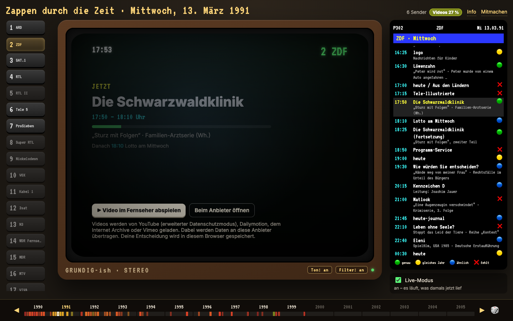

# Zappen durch die Zeit

**Was lief damals?** Deutsches Fernsehen der 90er – genau so, wie es heute vor über 30 Jahren um diese Uhrzeit lief. Echte Programmdaten, verlinkt mit vorhandenen Aufnahmen (YouTube, Internet Archive, Mediatheken). Wir hosten keine Videos.

Zu finden unter [zadudize.de](https://zadudize.de) – zadudize = **Za**ppen **du**rch **di**e **Ze**it. Ein privates, nicht-kommerzielles Projekt.



## So funktioniert's

- Jeder Tag ist ein echter Programmtag (06:00 bis 06:00 Uhr). Beim Einschalten läuft, was damals zur gleichen Uhrzeit lief – mit dem passenden Sprung in die Aufnahme.
- Durchzappen mit den Sendertasten, den Pfeiltasten oder der Zifferntastatur; Tage wählt man unten in der Zeitleiste oder im Kalender.
- Gibt es von einer Sendung keine Aufnahme, zeigt der Fernseher die Programmankündigung mit „Video vorschlagen“ – so wächst die Sammlung.
- Ohne „Wie damals“-Modus kann man im Programm jede Sendung des Tages frei anwählen.

## Einrichten

Voraussetzungen: Node.js 22 (`.nvmrc`), pnpm (`corepack enable pnpm`).

```sh
pnpm i
pnpm db:setup   # Datenbank anlegen und Programmtage importieren (lokales PGlite in .data/)
pnpm dev        # http://localhost:3000
```

Weitere Befehle: `pnpm lint`, `pnpm test`, `pnpm typecheck`, `pnpm build`, `pnpm format`, `pnpm ingest purge` (Aufbewahrungsfristen anwenden, läuft auch mit `pnpm ingest snapshot`).

### Umgebungsvariablen

Alle Variablen mit Zweck stehen in `apps/web/.env.example` (Kopie als `apps/web/.env.local`, nicht im Git). In Produktion startet der Server nicht ohne die ersten beiden und `DATABASE_URL`:

| Variable | Wofür |
|---|---|
| `SITE_URL` | Öffentliche Adresse (Link-Vorschauen, Sitemap, robots.txt) – Pflicht |
| `CONTRIBUTION_SECRET` | Formular-Tokens und tägliche IP-Hashes, mind. 32 Zeichen – Pflicht |
| `ADMIN_TOKEN`, `ADMIN_TOTP_SECRET` | Moderation: Passwort (mind. 20 Zeichen) und Zwei-Faktor (`pnpm ingest admin-totp`); in Produktion beide nötig |
| `CLIENT_IP_HEADER`, `TRUSTED_PROXY_HOPS` | Woher die Client-Adresse kommt (siehe „Hosting“) |
| `UPLOAD_DAILY_QUOTA_MB`, `UPLOAD_TOTAL_QUOTA_MB`, `UPLOAD_DIR` | Anhänge: Kontingent pro 24 h und gesamt, Ablageordner |
| `OWNER_NAME`, `OWNER_ADDRESS`, `OWNER_EMAIL` | Impressum, Datenschutzerklärung, Kontakt für Rechteinhaber |
| `DATABASE_URL` | Postgres statt lokalem PGlite – in Produktion Pflicht |
| `MIGRATIONS_DIR`, `UPLOAD_REVIEW_FILE`, `ARCHIVE_SEED_DIR` | Pfade für ein gebautes Image: Migrationen, Datei der aussortierten Uploads, Ordner der Archiv-Tage für den Import (Standard: im Repository) |
| `CSP_REPORT_ONLY` | `1` = Content-Security-Policy nur melden (zum Ausprobieren) |
| `SOURCE_URL` | Link „Quellcode“ auf Info-Seite und Impressum (AGPL); Standard: das GitHub-Repository |

### Vor dem ersten Push

- CI (`.github/workflows/ci.yml`): Typecheck, Lint, Tests, Build und `pnpm audit --prod` bei jedem Push und Pull Request; Dependabot prüft npm-Pakete wöchentlich, GitHub Actions monatlich.
- Im GitHub-Repository **Secret Scanning mit Push Protection** einschalten (Settings → Code security), damit kein Schlüssel versehentlich hochgeladen wird.
- Direkt vor dem Push prüfen, dass weder `.env*` (außer `.env.example`) noch `.data/` noch `.DS_Store` getrackt sind: `git ls-files | grep -E '\.env|\.data/|\.DS_Store'`.

### Hosting: Client-Adresse

Rate-Limits (Mitmachen, Video-Meldungen) und die Admin-Sperre hängen an der Adresse des Aufrufers. `next start` übernimmt einen vom Aufrufer mitgeschickten `X-Forwarded-For`-Header unverändert; die echte Adresse ist dann nicht zu erkennen. Deshalb:

- **Plattform mit eigenem Header** (Cloudflare `cf-connecting-ip`, Fly.io `fly-client-ip`, Vercel `x-vercel-forwarded-for` …): `CLIENT_IP_HEADER` auf diesen Header setzen.
- **Eigener Reverse-Proxy** (nginx `proxy_add_x_forwarded_for`, Caddy, Traefik), der die gesehene Adresse rechts anhängt: `TRUSTED_PROXY_HOPS` = Anzahl dieser Proxys (Standard `1`). Gezählt wird von rechts; der linke, vom Aufrufer gesetzte Teil wird nie verwendet.
- **`next start` ohne Proxy** öffentlich erreichbar: nicht empfohlen. Mit `TRUSTED_PROXY_HOPS=0` gelten alle Aufrufer als eine Adresse; die Admin-Anmeldung bleibt durch die globale Sperre (20 Fehlversuche in 15 Minuten) geschützt.

## Dokumentation

- [`ARCHITECTURE.md`](ARCHITECTURE.md) – Aufbau, Datenmodell, Zeitmodell, Wiedergabe, Modi, Moderation, Sicherheit
- [`docs/DATA.md`](docs/DATA.md) – Datenquellen, Dateiformat, angenommenes Programm, Regeln für Video-Links
- [`docs/DEPLOYMENT.md`](docs/DEPLOYMENT.md) – Betrieb auf einem Server: Voraussetzungen, Variablen, Proxy, Datenbank, Sicherung
- [`docs/OPERATIONS.md`](docs/OPERATIONS.md) – Betriebshandbuch: Moderation, Entfernen von Links, Schlüssel wechseln, Störungen
- [`CONTRIBUTING.md`](CONTRIBUTING.md), [`CODE_OF_CONDUCT.md`](CODE_OF_CONDUCT.md), [`SECURITY.md`](SECURITY.md)
- Ältere Arbeitspapiere: `docs/archive/`

## Datenquellen

- **Programmdaten:** echte Programme für rund jeden neunten Tag (2026-11: 374 von 3.545), fast alle von [tvprogramme.net](http://www.tvprogramme.net/), wo Freiwillige alte Programmzeitschriften abgetippt haben; einzelne Tage eigene Rekonstruktion aus öffentlichen Quellen. Alle übrigen Tage haben ein **angenommenes Programm** aus regelmäßigen Sendeplätzen (abgeleitet aus den echten Tagen und eigener Recherche) und datierten Aufnahmen. Die lokale Sicherungskopie der Website und die daraus erzeugten Tage (`.data/archive/`) sind **nicht** Teil des Repositorys; ohne sie importiert `pnpm db:setup` nur die kuratierten Tage aus `seed/`.
- **Videos:** Links auf vorhandene Aufnahmen (`seed/media-library.json` und die Tage in `seed/`), eingebettet nach Zustimmung – YouTube im erweiterten Datenschutzmodus, Dailymotion, Internet Archive, Vimeo; Mediatheken als Link.

## Rechtliches

Wir laden keine Videos herunter und hosten keine – es werden nur vorhandene Veröffentlichungen verlinkt oder eingebettet. Wer Rechte an einer verlinkten Aufnahme hat und sie hier nicht sehen möchte, schreibt bitte an [dev@thorbieshappyprojects.com](mailto:dev@thorbieshappyprojects.com) (auf der Website aus `OWNER_EMAIL`, siehe Impressum) oder nutzt das Mitmachen-Formular (`/mitmachen`); wir entfernen den Link umgehend.

Impressum (`/impressum`) und Datenschutzerklärung (`/datenschutz`) lesen die Betreiberangaben aus `OWNER_NAME`, `OWNER_ADDRESS` und `OWNER_EMAIL` (siehe `apps/web/.env.example`); solange sie fehlen, zeigen beide Seiten deutlich markierte Platzhalter. Die Texte vor dem öffentlichen Start rechtlich prüfen lassen.

Mitmachen: Videos, Programme oder Hinweise lassen sich unter `/mitmachen` einreichen; alles wird vor der Veröffentlichung von Hand geprüft.

## Lizenz

Copyright (C) 2026 Thorben Hoepke

Der Code steht unter der [GNU Affero General Public License 3.0](LICENSE) (`AGPL-3.0-only`). Wer eine veränderte Fassung öffentlich betreibt, muss deren Quellcode den Besucherinnen und Besuchern anbieten; die Website verlinkt dafür unter „Quellcode“ auf `SOURCE_URL`.

Betrieben wird die Website streng nicht-kommerziell: keine Werbung, keine Analyse-Dienste, keine Affiliate-Links, keine Spenden- oder Sponsoring-Knöpfe. Das beschreibt, wie wir die Seite betreiben – die AGPL selbst verbietet anderen die kommerzielle Nutzung des Codes nicht, verpflichtet sie aber, ihre Änderungen zu veröffentlichen.

Die Daten in `seed/` fallen nicht unter diese Lizenz – siehe [`seed/README.md`](seed/README.md).

## Kontakt

[dev@thorbieshappyprojects.com](mailto:dev@thorbieshappyprojects.com) – für Fragen, Hinweise von Rechteinhabern und Sicherheitsmeldungen (siehe `SECURITY.md`).
